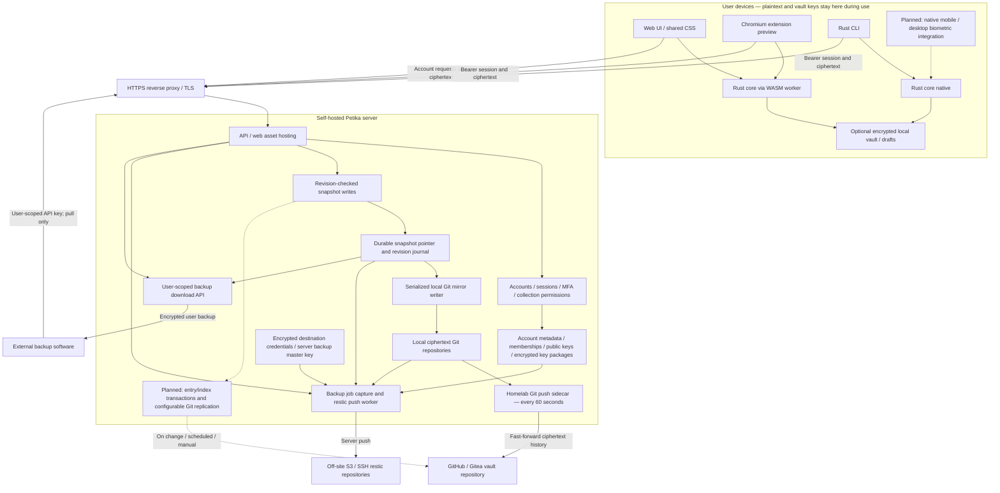

# Architecture

## Current boundaries

| Component | Purpose | Current state |
| --- | --- | --- |
| `petika-core` | Shared records, encryption, local storage | Standard/hybrid envelopes, record operations, local recipient identities/recovery, atomic native persistence |
| `petika` | Rust CLI | Offline password management, GPG import, managed login, live API reads/writes with passphrase or recipient unlock, encrypted collection pull/push |
| `petika-server` | Self-hosted API and web hosting | Accounts, permissions, provisioning, revision checks, snapshot journals, Git mirrors |
| `petika-web` and `clients/web` | Browser password manager | Rust/WASM encryption worker and JavaScript/CSS interface |
| `petika-desktop` | Native messaging and platform authentication | Library placeholder |
| Chromium extension | Password generation, approved-site autofill and TOTP | Unsigned preview; local WASM crypto, API access |
| Firefox/mobile apps | Platform autofill and biometric unlock | Not implemented |

## Full software diagram

Solid arrows describe implemented data flows. Dashed arrows and nodes marked
**planned** describe the agreed target, not available functionality.

The source-code repository is separate from the vault Git repository. Full-server
backups contain account/configuration state that the ciphertext-only Git mirror
does not; user backup exports have a narrower scope. Provider credentials and the
backup master key are server-managed and do not unlock client vault contents.
See [off-site backups](offsite-backups.md) for capture, encryption and restore details.

Browser clients still trust code delivered by their distribution channel; local
encryption alone does not protect against malicious replacement JavaScript.
Experimental Hybrid encryption is not a reviewed ML-KEM delivery profile. A
validated-module AES profile and independently reviewed device delivery remain
design work, not FIPS validation or production security claims.

Packages remain unpublished (`publish = false`). Cargo dependencies and the lockfile
are present. Storage and API formats are versioned but experimental; there is no stable
compatibility guarantee. See [schema upgrades](schema.md).

## Implemented data flow

Clients encrypt/decrypt locally using the shared Rust core. Server authentication is
separate from collection unlocking. The API authorizes personal/group collection access
and accepts whole encrypted snapshots using compare-and-swap revisions. Stale writes
are rejected; clients retain local changes for explicit resolution. There is no automatic
per-record merge. The CLI supports live reads/writes using `--collection`, local passphrase or
recipient-identity unlock, encrypted conflict drafts, and explicit pull/push; the web client saves encrypted drafts
and attempts synchronization.

Accepted snapshots are journaled and mirrored to separate local Git repositories. Git
is a one-way recovery mirror, not a writable synchronization peer. Remote Git replication
is an operator task. Accounts and memberships are server metadata outside the mirror.

Legacy groups use a collection passphrase out of band. Explicitly migrated groups use
verified per-user encrypted packages; enrollment, trust verification, delivery, and fresh-key
rotation are implemented in CLI/web. Administrators can manage membership but do not
automatically receive decryption keys. See [group access](group-access.md).

## Remaining design gates

The [group-key delivery design](decisions/0002-per-user-group-key-delivery.md) and
[wire format](key-package-format.md) define enrollment, packages, recovery, migration,
and explicit rotation. Keep account login separate from decryption authorization and
preserve Standard/Hybrid mode semantics. Independent cryptographic review and exhaustive
crash/concurrency hardening remain necessary before a production-readiness claim.

The Chromium preview uses local WASM; native messaging and mobile platform autofill
and biometric bindings remain planned. Platform packaging preserves the no-npm requirement.

The [Git sync design](research/git-vault-sync.md) makes the API the single write
authority for all managed clients. Entry-granular encrypted storage and selectable remote replication triggers
remain implementation gaps.

A revoked user/device may retain downloaded ciphertext, keys, and plaintext. Git history
retains old ciphertext. Rotation cannot erase passwords already disclosed. The server's
revision checks do not establish rollback resistance against a malicious server or a
restored old data directory.

Record architecture decisions with rationale and validation criteria before relying on
them in code. See the [local encryption decision](decisions/0001-local-encryption.md).
