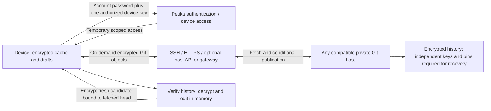
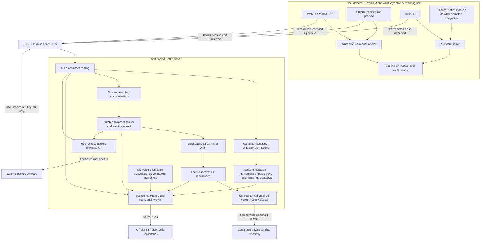

# Architecture

Implementation is tracked in the [ordered work plan](implementation-plan-git-biometric.md),
which maps existing code to missing work and gives each package dependencies and completion
criteria. The first code milestone is a persistent native credential with fresh biometric
approval for every synthetic Show/Copy operation.

## Accepted target: Git-authoritative sync

[ADR 0006](decisions/0006-git-authoritative-sync.md), accepted as direction on
2026-10-31, makes a private Git data repository the authoritative accepted encrypted
history. Implementation and migration are pending; the current runtime below still
uses the API and outbound mirrors.



Before online show/edit, fetch and verify from the retained checkpoint. A save commits
only when the destination atomically accepts the candidate against its expected head.
A competing update discards the stale submission, retains an encrypted user draft and
requires fetch, review/re-edit and a fresh encrypted candidate. Lost acknowledgements
require operation reconciliation before retry. No automatic ciphertext merging or force
updates. Cache-only viewing is an explicit offline mode.

Standard Git transports provide host independence; temporary credentials directly usable
at a host depend on that host's capabilities. An optional gateway retains protected
upstream credentials and offers temporary Petika access. Online access requires the account password and proof from any one authorized device
credential. Each device can open its own encrypted package for the same vault secret;
all keys are not required together. Account enrollment alone does not grant a shared vault.
Device vault keys stay local. Mandatory server participation in every decrypt remains
a separate undecided policy.

Registration requires supported biometric-only protection for a locally generated device
credential. Every secret action requires fresh approval; strings/PINs are not fallbacks. Web **Add device** presents an expiring QR pairing session;
scanning generates keys on the new device, followed by existing-authority fingerprint
approval, two-key possession proofs and verified biometric-only custody. The QR never contains vault/private keys and is
not an automatic grant. See [registration protocol direction](decisions/0006-git-authoritative-sync.md#registration-methods-and-qr-device-enrollment).
This UI and pairing relay are planned, not implemented.

Host-authorized temporary repository SSH-key leases can register a device's public
transport key and remove it on completion/expiry via host management APIs. This requires
a durable cleanup/reconciliation ledger; ordinary deploy keys do not enforce expiry
themselves. Strict expiry requires a host-validated certificate or lease-checking gateway.
Private transport keys stay on devices; secret access still requires per-action biometrics.
The [cleanup engine](git-key-lease-cleanup.md) now provides a durable lease inventory,
scoped revocation, restart retries and late-registration reconciliation under the
experimental device feature. Host adapters and scheduler/account integration are still
pending; no live key issuance/deletion is enabled.

Shared-vault ACLs, publication/revocation ordering, signed tree/ref and receipt formats,
browser transport, durable device custody and complete recovery are release gates.
Branches do not isolate repository readers. The [implementation sequence](research/git-vault-sync.md)
starts with a disposable private vault and two clients. Migrate per collection with one
explicit authority; never independently accept writes through both Git and the legacy API.

## Mandatory biometric authorization boundary

The target online model is account password/session plus any permitted device credential,
with **fresh biometric approval for every secret action**. Login, Git tokens, prior
biometric success, QR scanning and ciphertext cache possession never authorize secret
access. This supersedes the earlier string-unlock alternative. The current runtime does
not enforce this target; existing CLI/browser/legacy recovery paths need explicit migration.

```mermaid
sequenceDiagram
    participant UI as Web / extension / CLI / native UI
    participant Broker as Trusted native credential broker
    participant Server as Petika authorization
    participant OS as Biometric-only protected key access
    UI->>Broker: Typed secret action + target + nonce
    Broker->>Server: Account session + device/action context (online)
    Server-->>Broker: Fresh bounded challenge / authorization
    Broker->>OS: New biometric-only approval for this operation
    alt Fresh biometric succeeds and action authorized
        OS-->>Broker: One protected key operation
        Note over Broker: Verify state; unwrap/decrypt transiently; execute bound action
        Broker-->>UI: Minimum intended output, never reusable keys
        Note over Broker: Consume action; clear transient secrets
    else Cancelled, unavailable, failed or unsupported
        Broker-->>UI: Denied; no fallback
    end
```

The same boundary covers reveal, copy, autofill, TOTP, secret-bearing previews/search,
secret edits/saves, import/export and offline viewing. Ciphertext-only sync and public
history verification can operate without a biometric. A new user action needs a new
approval; secret actions cannot fan out into hidden batches. Edit/display lifetimes must
be bounded; approving an editor does not approve later copy/export or a changed save.

Put key access and secret processing in a trusted native broker. Avoid reusable decrypted
bundles or epoch keys in the UI, browser worker, extension content scripts or an unlocked
vault cache. Configure per-use biometric-only platform key protection, fresh contexts,
current-set invalidation and denial on biometric lockout/cancellation. Return minimum
outputs; clear buffers and end display/clipboard lifetimes with best-effort OS limits.

Server challenges bind device, action, collection/entry scope, epoch/head, nonce and expiry.
Their exact proof format, biometric evidence and atomic consumption/publication ordering
remain implementation gates. A device signature or ordinary WebAuthn UV bit alone does
not establish biometric-only use. Browser access requires an enforceable native bridge
or independently reviewed equivalent; unsupported devices cannot process secrets.
A string or recovery kit may not become a hidden bypass: recovery must provision an
approved biometric-protected device under an explicit reviewed ceremony.

Hardware-specific policy, browser distributions, per-action custody and negative-path
coverage must pass the [acceptance plan](testing/git-authoritative-sync.md) before enablement.
Read the [full enforcement contract and platform sources](decisions/0006-git-authoritative-sync.md#mandatory-biometric-approval-for-every-secret-action).
This policy assumes trusted client/OS execution; once plaintext is revealed it can be
copied, and compromised processes remain outside an absolute no-extraction guarantee.

The first [synthetic macOS broker slice](../experiments/biometric-unlock/broker/README.md)
now persists enclave-wrapped generated state and executes separate protected Show/Copy
actions. It is an experiment inside one process; product isolation, lifecycle enforcement
and client integration remain pending. See [evidence](testing/device-broker-2026-10-31.json).

## Current boundaries

| Component | Purpose | Current state |
| --- | --- | --- |
| `petika-core` | Shared records, encryption, local storage | Standard/hybrid envelopes, record operations, local recipient identities/recovery, atomic native persistence |
| `petika` | Rust CLI | Offline password management, GPG import, managed login, live API reads/writes with passphrase or recipient unlock, encrypted collection pull/push |
| `petika-server` | Self-hosted API and web hosting | Accounts, permissions, provisioning, revision checks, snapshot journals, Git mirrors |
| `petika-web` and `clients/web` | Browser password manager | Rust/WASM encryption worker and JavaScript/CSS interface |
| `petika-desktop` | Native messaging and platform authentication | Library placeholder |
| Chromium extension | Password generation, approved-site autofill and TOTP | Unsigned preview; local WASM crypto, API access |
| Firefox/mobile apps | Platform autofill and biometric unlock | Not implemented |

## Current software diagram

Solid arrows describe implemented data flows. Dashed arrows and nodes marked
**planned** describe the agreed target, not available functionality.



The source-code repository is separate from the vault Git repository. Full-server
backups contain account/configuration state that the ciphertext-only Git mirror
does not; user backup exports have a narrower scope. Provider credentials and the
backup master key are server-managed and do not unlock client vault contents.
See [off-site backups](offsite-backups.md) for capture, encryption and restore details.

Browser clients still trust code delivered by their distribution channel; local
encryption alone does not protect against malicious replacement JavaScript.
Experimental Hybrid encryption is not a reviewed ML-KEM delivery profile. A
validated-module AES profile and independently reviewed device delivery remain
design work, not FIPS validation or production security claims.

Packages remain unpublished (`publish = false`). Cargo dependencies and the lockfile
are present. Storage and API formats are versioned but experimental; there is no stable
compatibility guarantee. See [schema upgrades](schema.md).

## Implemented data flow

Clients encrypt/decrypt locally using the shared Rust core. Server authentication is
separate from collection unlocking. The API authorizes personal/group collection access
and accepts whole encrypted snapshots using compare-and-swap revisions. Stale writes
are rejected; clients retain local changes for explicit resolution. There is no automatic
per-record merge. The CLI supports live reads/writes using `--collection`, local passphrase or
recipient-identity unlock, encrypted conflict drafts, and explicit pull/push; the web client saves encrypted drafts
and attempts synchronization.

Accepted snapshots are journaled and mirrored to separate local Git repositories. Git
is a one-way recovery mirror, not a writable synchronization peer. Remote Git replication
is an operator task. Accounts and memberships are server metadata outside the mirror.

Legacy groups use a collection passphrase out of band. Explicitly migrated groups use
verified per-user encrypted packages; enrollment, trust verification, delivery, and fresh-key
rotation are implemented in CLI/web. Administrators can manage membership but do not
automatically receive decryption keys. See [group access](group-access.md).

## Remaining design gates

The [group-key delivery design](decisions/0002-per-user-group-key-delivery.md) and
[wire format](key-package-format.md) define enrollment, packages, recovery, migration,
and explicit rotation. Keep account login separate from decryption authorization and
preserve Standard/Hybrid mode semantics. Independent cryptographic review and exhaustive
crash/concurrency hardening remain necessary before a production-readiness claim.

The Chromium preview uses local WASM; native messaging and mobile platform autofill
and biometric bindings remain planned. Platform packaging preserves the no-npm requirement.

The [Git sync target](research/git-vault-sync.md) and [ADR 0006](decisions/0006-git-authoritative-sync.md)
now supersede the sole-server-writer target. Existing gated entry/index transactions,
verified history, CLI drafts and ordered server replication remain reusable implemented
foundations; they do not yet make Git authoritative. See the current
[entry transport contract](research/entry-history-transport.md) and
[device account API](device-account-api.md) for exact implemented boundaries.

A revoked user/device may retain downloaded ciphertext, keys, and plaintext. Git history
retains old ciphertext. Rotation cannot erase passwords already disclosed. The server's
revision checks do not establish rollback resistance against a malicious server or a
restored old data directory.

Record architecture decisions with rationale and validation criteria before relying on
them in code. See the [local encryption decision](decisions/0001-local-encryption.md).
