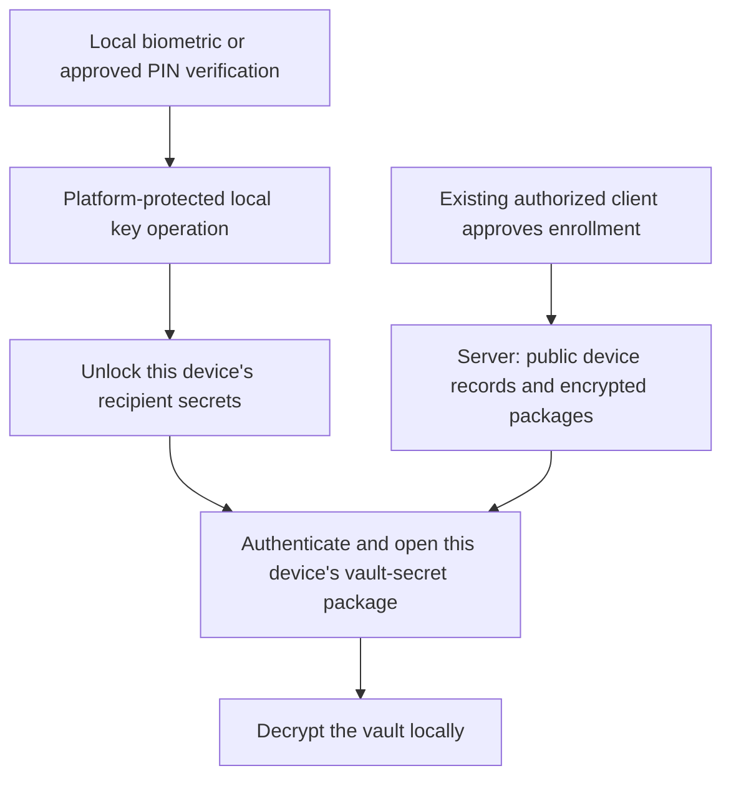

# Multiple device keys and biometric vault unlock

Research date: 2026-10-18. Repository baseline: `9fc3520`.
Status: researched proposal; no protocol approval, hardware prototype or implementation.
Related plan: [security alignment](../security-alignment-plan.md), SEC-04–09.

## Finding and recommendation

Yes: multiple devices can each hold a different protected key and independently
unlock the same vault. Biometrics authorize local key use; Petika should not derive
keys from fingerprints or faces, collect biometric templates, or send them to its server.

Recommend separate device recipient identities, locally protected by a platform key,
with an authenticated vault-secret package for each authorized device. Encrypt vault
contents once per collection/key epoch, not once per device. Account authentication,
device enrollment, local unlock and recovery remain separate permissions.

This is a proposed extension of the [accepted architecture](../decisions/0003-security-and-recovery-baseline.md),
not a replacement for the implemented [per-user identity protocol](../decisions/0002-per-user-group-key-delivery.md).
Enrollment authority, format migration and platform capability tests must be reviewed
before it becomes an accepted protocol.

## Current implementation and two possible paths

Current [identity code](../../crates/petika-core/src/identity.rs) provides one recipient
identity per user, shared across devices. The encrypted private bundle holds encryption
and signing material. [Vault code](../../crates/petika-core/src/crypto.rs) distinguishes
Standard data-key material from Hybrid X-Wing seed material; device delivery must
preserve that distinction rather than assuming every wrapped secret is an AES key.

| Approach | Benefit | Limitation | Recommendation |
| --- | --- | --- | --- |
| Local biometric wrapper around today's shared identity | Convenient unlock; potentially smaller initial change | Every enrolled device still learns the same identity secrets; deleting one wrapper does not revoke that device cryptographically | Optional transitional feature, labeled local unlock only |
| Distinct device identities and packages | Separate enrollment and future key delivery; device inventory and replacement | Requires new authorization, package, recovery and migration contracts | Target architecture |

Neither approach erases secrets already copied by a device. More enrolled devices
also means more possible compromise points; device count is not itself a security improvement.

## Proposed key flow

The platform protection key and the device recipient keys have different jobs.
A non-exportable platform key can protect a serialized software recipient bundle,
allowing the existing X25519/X-Wing implementation to run after local unlock. That
means recipient secrets and vault plaintext enter application memory; it does not
place all Petika cryptography inside secure hardware. Separate signing and encryption
keys by purpose. Final KDF, AEAD, encodings and key permissions need reviewed fixtures.

A public package should bind deployment, immutable user/device IDs, recipient key
fingerprint/version, collection, suite, epoch, issuer and authorization state. Reject
substitution, stale authorization and unknown suites. Extending today's package schema
requires a new version; old clients reject unknown fields.

## Platform capability matrix

These are documented primitives, not tested Petika support or a minimum-version promise.

| Platform | Documented mechanism | Proposed use and unresolved validation |
| --- | --- | --- |
| Native Apple | Secure Enclave P-256 key agreement; Keychain access controls | Protect a device bundle using supported hardware operations or a biometric-gated Keychain item. Verify API choice, device-only storage, entitlement/access-group isolation and actual hardware support. Do not assume X25519/X-Wing execute in the enclave. |
| Native Android | Android Keystore; authentication-bound operations through BiometricPrompt/CryptoObject; optional StrongBox | Prototype an authentication-per-use wrapping key. Check security level and algorithm support on the actual device; no silent fallback from required hardware protection. |
| Native Windows | Windows Hello KeyCredential signs challenges; TPM provides protected cryptographic operations | Hello authentication alone is insufficient evidence of a decrypt-capable, biometric-bound wrapping path. Prototype and review the exact CNG/TPM or other supported API before selecting it. |
| Browser/PWA | WebAuthn PRF can yield a credential-associated secret for a wrapping-key derivation | Feature-detect PRF output and test browser/OS/authenticator combinations. Require user verification and keep PRF outputs out of server requests, logs and analytics. Authentication-only passkeys are insufficient. |
| Linux/CLI | No uniform biometric/hardware path established by this research | Keep explicit passphrase recovery/unlock; investigate platform keystores and external authenticators separately. Do not claim parity based on an unlocked desktop keyring. |

Apple documents P-256 ECDH inside Secure Enclave and biometric enrollment-bound item
invalidation. These are distinct from exporting a reusable biometric secret.
[Apple key agreement](https://developer.apple.com/documentation/cryptokit/secureenclave/p256/keyagreement),
[Apple biometric access control](https://developer.apple.com/documentation/security/secaccesscontrolcreateflags/biometrycurrentset).

Android documents non-exportable Keystore keys, differing hardware security levels,
and authentication-per-use cryptographic operations. Hardware availability must be
checked, not inferred from the presence of a fingerprint sensor.
[Android Keystore](https://developer.android.com/privacy-and-security/keystore),
[Android biometric cryptography](https://developer.android.com/identity/sign-in/biometric-auth).

Microsoft's application example uses Hello to sign an authentication challenge. It
must not be repurposed by assuming a signature is a stable secret encryption key.
[Windows Hello application APIs](https://learn.microsoft.com/en-us/windows/apps/develop/security/windows-hello),
[TPM fundamentals](https://learn.microsoft.com/en-gb/windows/security/hardware-security/tpm/tpm-fundamentals).

WebAuthn PRF provides credential-associated outputs suitable for encryption use cases;
extensions can be unavailable. A synced credential is not necessarily a unique physical
device boundary. Record credential backup properties where available, but do not infer
hardware provenance from a successful biometric prompt. Test sync, replacement and
cross-device invocation behavior explicitly.
[W3C PRF explainer](https://github.com/w3c/webauthn/blob/main/explainers/prf-extension.md),
[WebAuthn specification](https://www.w3.org/TR/webauthn/).

## Enrollment, revocation and recovery

1. A new client generates its device identity locally and proves possession. Signing
   possession alone is insufficient: test encryption-key consistency as well.
2. An existing trusted client verifies the request through a bound QR code or other
   authenticated channel, including deployment, user, device keys, expiry and a fresh
   challenge. The server cannot authorize a new decryption recipient by itself.
3. A reviewed device-authorization record permits the new recipient. Define whether
   ordinary devices may enroll others, and how account-level authority is recovered.
   Do not distribute an unrestricted enrollment root to every device by default.
4. An authorized client with access to a collection creates its device package under
   that collection's sharing policy. Enrollment alone must not grant new collections
   or bypass existing group editor/recipient-verification rules.
5. Revocation denies server access and package issuance, then an authorized client
   rotates affected collection secrets and distributes the new epoch only to retained
   recipients. Old packages and plaintext remain readable to their previous holders.
6. Recovery uses a separately retained recovery kit or explicitly authorized recovery
   holders to enroll replacement hardware and restore access. Account reset alone
   cannot reconstruct keys. If all authorized secrets and recovery material are lost,
   the ciphertext is unrecoverable.

The signed device roster needs versioning, conflict handling and rollback protection.
A new device cannot establish freshness from an untrusted server alone. Determine how
an existing device transfers its latest trusted checkpoint, and what assurances remain
when recovery is the only surviving authority. Do not describe signatures alone as
protection against server equivocation.

Historical backup restoration must preserve revocation knowledge and avoid silently
reactivating old devices. Keep recovery packages compatible with retained backup epochs;
rotating current secrets does not retroactively protect previously captured backups.

## Local unlock policy and assurance boundaries

Proposed default: require a cryptographically enforced user-verification operation
when opening a locked vault, then use a bounded in-memory unlock session. Require
fresh verification for device enrollment, recovery changes and sensitive exports.
Do not prompt for every entry by default; determine session timeout and background-lock
behavior through threat review and usability testing. Never implement protection as
only a successful dialog followed by unrestricted key-file access.

Make biometric-only versus device-PIN/passcode fallback explicit. Biometric enrollment
changes can invalidate protected keys; recovery and re-enrollment must be tested before
such a policy ships. A fallback is another access path and must meet the stated policy.
The server generally cannot prove which local gesture a browser used.

NIST treats biometrics as an activation factor in conjunction with a physical
cryptographic authenticator, not a standalone secret. Non-exportable authentication
keys and the complete lifecycle matter for assurance; synced authenticators cannot
be advertised as AAL3 merely because a biometric was used.
[NIST SP 800-63B-4](https://pages.nist.gov/800-63-4/sp800-63b.html).

A classical wrapper exposing a Hybrid secret creates an additional classical attack
path when an attacker can capture that wrapper. Review every stored/exported wrapper,
including recovery paths; a Hybrid inner vault does not neutralize weaker outer access
paths. Separately assess FIPS module boundaries: hardware protection, biometrics and
use of a NIST curve do not prove Petika is FIPS validated.

Compromised unlocked clients can steal plaintext or software recipient keys. Malicious
server-delivered JavaScript can misuse unlocked browser secrets/PRF outputs. Verified
native distribution reduces that delivery threat but does not solve client compromise.

## Next work and acceptance evidence

Research establishes feasibility, not production readiness. The next bounded work is
an isolated Apple-device and browser-PRF capability spike with synthetic keys only,
followed by Android/Windows validation when suitable test hardware is available.
Do not change production formats or enroll real vault keys during the spike.

- [ ] Record OS/browser/app/authenticator versions, actual hardware security level,
  key export behavior, PRF support, credential sync properties and fallback behavior.
- [ ] Verify cancellation, lockout, reboot, screen lock, backgrounding, biometric-set
  change, device passcode reset, application reinstall and hardware replacement.
- [ ] Show two distinct device recipients opening one synthetic collection in both
  modes; after revocation/rotation, the old recipient fails on the new epoch while
  historical ciphertext remains readable as expected.
- [ ] Exercise forged enrollment, replay, key substitution, stale roster, concurrent
  enroll/revoke, restored old state and loss of every ordinary device.
- [ ] Confirm no PRF output, key or plaintext appears in requests, logs, diagnostics
  or backups outside its intended encrypted wrapper; inspect unlocked-memory limits.
- [ ] Draft a separate protocol ADR and migration specification, including authority
  and group-sharing rules, authenticated formats, rollback limits and recovery.
- [ ] Obtain independent protocol review before claiming per-device cryptographic
  revocation or promoting the design beyond experimental status.

Open decisions: supported first native client; enrollment authority/quorum; offline
revocation semantics; synced-passkey policy; fallback requirements; session duration;
recovery custody; validated and Hybrid suite compatibility. No choice is silently
resolved by this research document.
